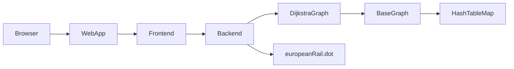

# European Rail Navigator

A Java route-finding web application built around a custom implementation of **Dijkstra's shortest-path algorithm**.

The program reads a directed weighted graph of European rail connections from `europeanRail.dot`, exposes route queries through a small HTML frontend, and serves the result with Java's built-in `HttpServer`.

## Project Highlights

- **118 rail locations**
- **788 directed connections** weighted by travel time in minutes
- shortest-path lookup between two cities
- path reconstruction with predecessor links
- total travel-time calculation
- furthest-reachable-route lookup from a selected city
- custom `HashTableMap` backing the graph's node storage
- browser-based interface without an external web framework

## Core Algorithm: Dijkstra

The main algorithm is implemented in [`DijkstraGraph.java`](DijkstraGraph.java).

For a requested start and destination, the implementation:

1. creates a `SearchNode` for the start vertex;
2. stores candidate routes in a Java `PriorityQueue`, ordered by cumulative path cost;
3. repeatedly removes the lowest-cost candidate;
4. marks finalized graph nodes in a custom hash table;
5. expands outgoing edges to generate new candidate paths; and
6. reconstructs the winning route by walking predecessor references backward from the destination.

`shortestPathData()` returns the ordered sequence of locations, while `shortestPathCost()` returns the total edge weight.

## Architecture



### Main Components

| Component | Purpose |
| --- | --- |
| `WebApp.java` | Starts the HTTP server and connects request parameters to the application components. |
| `Frontend.java` | Generates the HTML prompts and route-result markup. |
| `Backend.java` | Loads DOT graph data and exposes route-oriented operations. |
| `DijkstraGraph.java` | Implements shortest-path search and path reconstruction. |
| `BaseGraph.java` | Stores nodes and directed weighted edges. |
| `HashTableMap.java` | Custom separate-chaining hash table used by the graph. |
| `europeanRail.dot` | Weighted European rail-network data. |

## Running Locally

### Requirements

- Java JDK 17+ recommended
- `make` is optional; the equivalent `javac`/`java` commands are shown below

### Start the web application

```bash
make run
```

Equivalent commands:

```bash
javac Backend.java BackendInterface.java BaseGraph.java DijkstraGraph.java \
      Frontend.java FrontendInterface.java GraphADT.java HashTableMap.java \
      MapADT.java WebApp.java
java WebApp 8000
```

Open `http://localhost:8000` in a browser.

### Run smoke tests

```bash
make test
```

The smoke test verifies basic hash-table behavior and a known shortest path through a small graph without requiring JUnit.

### Generate one HTML response from the command line

```bash
make demo
```

This runs an example `Paris -> Berlin` query and prints the generated page to standard output.

## Data Format

The rail network uses a DOT-like directed-graph format:

```text
"Amsterdam" -> "Cologne" [minutes=157];
"Berlin" -> "Hamburg" [minutes=102];
```

Each edge weight represents travel time in minutes.

## Project Context and Attribution

This was developed as the final integration project for UW–Madison COMP SCI 400. The repository version has been cleaned for portfolio use: grader files, compiled classes, nested repository metadata, placeholders, and submission infrastructure were removed.

My authored contributions include the frontend, Dijkstra implementation, custom hash table, and later integration fixes. The backend originated from a teammate and some interfaces/web-server scaffolding originated from course starter code. See [`ATTRIBUTION.md`](ATTRIBUTION.md).
